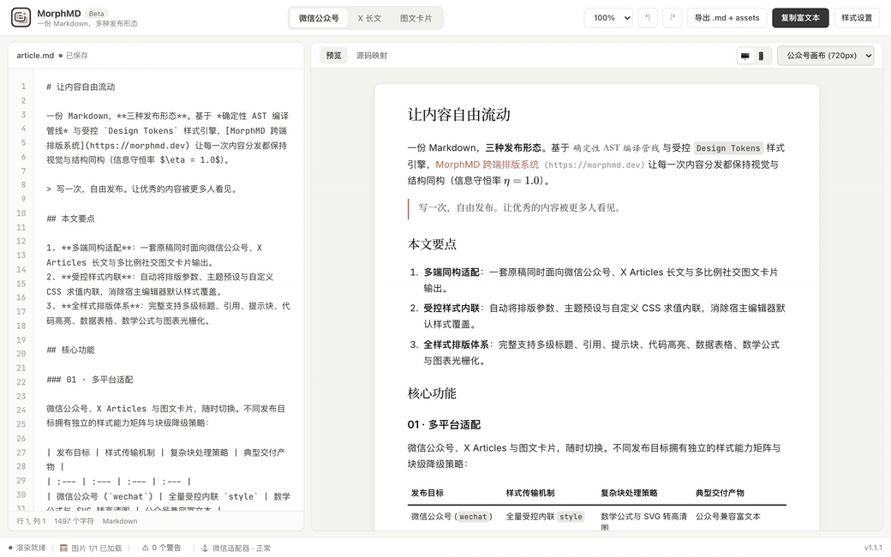

<div align="center">


# MorphMD

**一源多态 · 三端同构 · 自由定制 —— 面向多渠道创作者的统一 Markdown 排版工作台**

一次编写 Markdown 与粘贴图片，即可在**微信公众号**、**X Articles 长文**与**多比例图文卡片**（3:4 / 4:5 / 1:1 / 16:9）之间实时同构预览与交付。<br>
告别反复手动调格式与切图排版，以原稿零污染的静态资产管线与受控 CSS 引擎，让多端发布行云流水。


<br>

<a href="images/demo.mp4">
  
</a>

</div>

## Core ideas

- **一源多态，三端同构发布** —— 坚持原稿语义零篡改，同一份 Markdown 原稿同时编译驱动微信公众号长文、X Articles 原生富文本与多页社交图文卡片三种目标形态，实现全网分发一次成型。
- **极速贴图与干净原稿资产库** —— 编辑器无感拦截图片粘贴与拖拽，自动入库本地 `AssetStore` 并生成简洁的 `morph-asset://<id>` 引用；绝不在 Markdown 源码中写入任何臃肿的 Base64 字符串，后台自动完成跨端尺寸解码与就绪表示生成。
- **全屏与选区所见即所得复制** —— 预览区呈现效果与最终导出 1:1 绝对同构；不仅支持顶部一键复制全文富文本，还能像原生网页一样在右栏任意用鼠标框选段落图文（`Cmd/Ctrl + C`），选区上下文重建器自动补全外层祖先标签与白名单样式，剔除多余页眉页脚，即粘即发。
- **多比例智能卡片流式分页** —— 内置 `3:4`、`4:5`、`1:1`、`16:9` 四种主流社交画布比例，采用 Look-back Reflow 回溯重排算法对内容高度进行亚像素测量，自适应切页并防止超高原子块断层，支持单页复制与高清 ZIP/PNG 批量导出。
- **受控样式引擎与 Design Tokens** —— 基于 CSS-Tree 对用户自定义 CSS 执行 AST 级语法安全校验与两阶段受控内联；内置 9 项标准 Design Tokens 支持主题色与纸张模式动态联动，伪元素（`::before` / `::after`）自动物化为真实内联 DOM，兼备极致视觉美感与沙箱安全。

| 场景 | 触发方式 / 目标标识 | 排版与降级行为说明 |
| :--- | :--- | :--- |
| **微信公众号** | 顶栏切换至 **「微信公众号」** (`wechat`) | 样式强制求值并内联至节点 `style` 属性；外部超链接降级为行内文本并在文末自动展开 URL；数学公式与 SVG 编译为自包含矢量/位图 |
| **X 长文** | 顶栏切换至 **「X 长文」** (`x-article`) | 剥离所有内联 CSS，保留 X 平台原生支持的标题、段落、列表与引用标签；表格、数学公式、复杂代码块与 SVG 自动光栅化为高清 Retina 位图保真呈现 |
| **图文卡片** | 顶栏切换至 **「图文卡片」** (`cards`) | 启用多比例智能流式分页；支持 `3:4`（小红书）、`4:5`（Instagram）、`1:1`（方形配图）、`16:9`（横屏长图）；支持卡片页眉页脚与高清批量导出 |
| **极速贴图与框选复制** | 粘贴/拖拽图片，或右栏按住鼠标框选按 `Cmd/Ctrl + C` | 粘贴图片立即生成 `morph-asset://` 短引用；局部框选复制通过 Selection Normalizer 自动向上补齐缺失的祖先容器与样式，剥离冗余页码 |
| **受控 CSS 与 Design Tokens** | 右侧抽屉 **「样式设置 / 自定义 CSS」** | 引用 `var(--morph-accent)`、`var(--morph-ink)` 等变量联动主题；CSS-Tree 自动拦截 `position: fixed` 等破坏性属性，伪元素自动物化为实体标签 |

## Get started

1. **本地运行或打开在线工作台**
   - **在线访问**：直接在现代化浏览器中打开 MorphMD 线上工作台（无需安装任何环境，数据全本地存储）。
   - **本地启动与源码构建**：
     ```bash
     git clone https://github.com/yoryon/MorphMD.git
     cd MorphMD
     npm install
     npm run dev
     ```
2. **编写 Markdown 并切换三端视图与画布比例**
   - 在左侧编辑区撰写 Markdown，支持直接从剪贴板粘贴截图或拖入本地图片（自动生成零污染短引用）。
   - 在顶部视图切换栏点击 **「微信公众号」**、**「X 长文」** 或 **「图文卡片」**；在卡片模式下可下拉切换 `3:4`、`4:5`、`1:1`、`16:9` 画布比例并实时查看分页切片。
3. **定制主题 CSS 并一键复制富文本或导出高清卡片**
   - 点击右上角 **「样式设置」**，选择预设样式或在自定义 CSS 面板中微调排版细节（支持实时语法与平台能力诊断）。
   - 点击顶部 **「复制富文本」**，或直接在预览区鼠标框选段落（`Cmd/Ctrl + C`）后粘贴至目标发布后台；卡片模式可点击 **「导出高清卡片」** 下载高清 ZIP 包。
   - 开发者如需进行工程与规范验收，可在仓库根目录执行自检：
     ```bash
     harness doctor
     ```

## Learn more

- **工程与架构文档**：
  - [通用 Agent 协作规范与验收纪律 (AGENTS.md)](AGENTS.md)
  - [项目定位与领域红线 (PROJECTS.md)](PROJECTS.md)
  - [项目文档导航与维护规范 (docs/README.md)](docs/README.md)
  - [全局架构现状与核心数据流 (docs/architecture/overview.md)](docs/architecture/overview.md)
  - [外部参考与规范索引 (docs/reference/INDEX.md)](docs/reference/INDEX.md)
- **架构决策记录 (ADR)**：
  - [ADR-0002：同构交付快照与静态资产管线方案](docs/adr/0002-isomorphic-delivery-snapshot-and-asset-pipeline.md)
- **版本与开源协议**：
  - [版本变更记录 (CHANGELOG.md)](CHANGELOG.md) · 基于 [MIT License](LICENSE) 开源。
