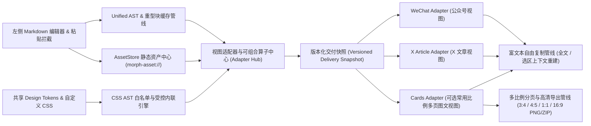
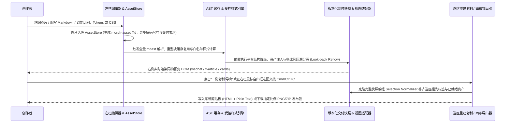

# 全局架构现状 (Architecture Overview)

> 本文件仅维护全局主干（两张 Mermaid 图 + 一组核心约束）。当前处于架构基线就绪态，具体子系统或领域细节请在 `docs/architecture/` 下按需平铺新建专题 `.md` 文件。

## 1. 模块边界与源码地图

- **编辑器与静态资产中心（`AssetStore`）**：负责 Markdown 源码输入、预设主题切换（Design Tokens）、自定义 CSS 编辑，以及拦截粘贴/拖拽图片生成 `morph-asset://<id>` 短引用并管理异步资产状态机。
- **AST 与样式计算管线**：基于 Unified / Remark / Rehype 执行全量轻量 `mdast` 解析与重型节点（Shiki / KaTeX / 派生图）缓存；通过 CSS AST 提取声明白名单并结合浏览器计算样式完成受控内联与平台样式能力守卫（见 [ADR-0002](../adr/0002-isomorphic-delivery-snapshot-and-asset-pipeline.md)）。
- **视图适配器与版本化交付快照**：挂载 `wechat`、`x-article`、`cards` 视图适配器，前置完成平台结构转换、资产绑定与多比例分页，生成唯一版本化交付快照驱动右侧同构预览。
- **自由复制与导出管线**：支持顶部一键全文复制与右侧预览区原生框选（`Cmd/Ctrl + C`）图文一体复制（含选区祖先标签重建与页眉/页脚剥离），以及 `cards` 视图在常用画布比例下的高清 PNG / ZIP 批量导出。

## 2. 核心执行链路与数据流

- **关键数据流**：`Markdown Source + AssetStore (morph-asset://)` $\rightarrow$ `Unified AST + Controlled Style Inlining` $\rightarrow$ `Versioned Delivery Snapshot` $\rightarrow$ `Isomorphic Preview DOM` $\rightarrow$ `Selection Context Normalizer (Clipboard) / Multi-ratio Canvas Rasterizer`。

## 3. 系统不变量与边界约束

- **单一语义 AST 与唯一交付快照（Single AST & Delivery Snapshot）**：所有视图适配器必须基于同一棵解析后的语法树派生输出，严禁维护私有正则或方言（见 [PROJECTS.md](../../PROJECTS.md)）；同构预览、全文复制、局部选区复制与卡片导出必须消费同一份已就绪的版本化交付快照。
- **静态资产状态机与右栏选区自由复制契约**：左栏源码严禁直接内嵌巨型 Base64 字符串，统一通过 `morph-asset://<id>` 引用；右栏局部框选复制必须经选区上下文重建器（Selection Context Normalizer）恢复外层块级/行内语义标签与样式、剔除生成性页眉页脚，并将图片/公式替换为已就绪的跨端交付表示。
- **受控自定义 CSS 与平台样式能力守卫**：自定义 CSS 经 CSS AST 白名单校验与浏览器受控计算样式提取后内联至支持平台（如 `wechat`），对受限语义平台（如 `x-article`）仅作用于降级图片块并输出显式诊断；严格隔离宿主 UI 样式与未授权脚本/协议。
- **多比例图文确定性分页与防死循环约束**：`cards` 视图在切换任意预设画布比例（如 `3:4` `1440×1920`、`4:5` `1440×1800`、`1:1`、`16:9`）或字号边距时，必须支持从受影响页的前一页检查点回溯重排（Look-back Reflow），对超出单页高度的超高原子块自动执行等比缩放或拆分兜底，严禁吞字、丢段或产生空白废页。
