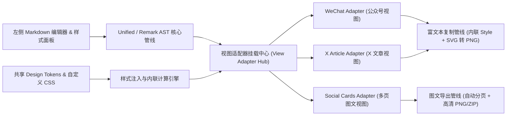
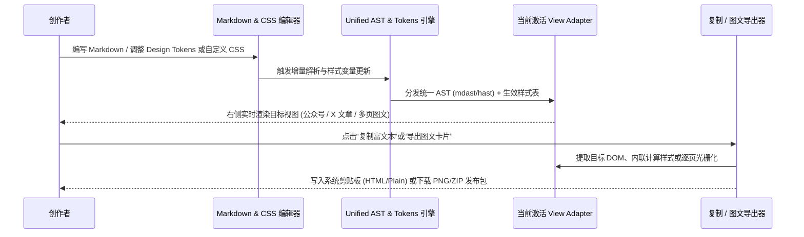

# 全局架构现状 (Architecture Overview)

> 本文件仅维护全局主干（两张 Mermaid 图 + 一组核心约束）。具体子系统或领域细节请在 `docs/architecture/` 下按需平铺新建专题 `.md` 文件。

## 1. 模块边界与源码地图

- **编辑器与样式面板**：负责 Markdown 源码输入、实时状态同步、预设主题切换（Design Tokens）及用户自定义 CSS 编辑。
- **AST 核心管线**：基于 Unified / Remark / Rehype 构建单一 Markdown AST，统一解析 GFM、代码高亮、数学公式与媒体节点（见 [ADR-0001](../adr/0001-unified-ast-and-pluggable-view-adapters.md)）。
- **视图适配器挂载中心（View Adapter Hub）**：向右侧预览区提供统一 Tab 切换协议（`wechat` / `x-article` / `social-cards`），共享同一棵 AST 与同一套设计变量。
- **复制与导出管线**：针对公众号与 X 文章执行样式内联及剪贴板富文本写入；针对图文卡片执行客户端流式分页测量与高分图片包导出。

## 2. 核心执行链路与数据流

- **关键数据流**：`Markdown Source` -> `Unified AST (mdast -> hast)` + `Design Tokens & Custom CSS` -> `ViewAdapter.render()` -> `Clipboard / Canvas Rasterizer`。

## 3. 系统不变量与边界约束

- **单一 AST 真相源（Single AST Source）**：所有视图适配器必须消费同一棵解析后的语法树，严禁各视图自行维护互不兼容的正则替换或私有 Markdown 方言（见 [PROJECTS.md](../../PROJECTS.md)）。
- **自定义 CSS 跨管线保真**：用户在自定义 CSS 面板中编写的规则，不仅在浏览器预览区生效，在执行“复制到公众号”时必须经样式内联器展开为行内 `style`，在执行“导出图文”时必须完整体现在导出的每张卡片画布中。
- **图文分页完整性约束**：`social-cards` 视图在任意字号/边距配置下执行自动分页时，严禁吞字、丢段或改变原稿段落顺序；超长列表与表格须支持跨页拆分，且首尾不产生空白废页。
