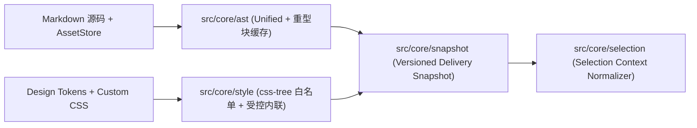

# 实现 MorphMD 核心编译管线、AssetStore、受控 CSS 白名单内联与选区重建内核

> **Status:** Proposal · [Issue #2](https://github.com/nanzhi84/MorphMD/issues/2) · Created 2026-10-23
> **Affected Architecture:** [docs/architecture/overview.md](../../architecture/overview.md) · [ADR-0002](../../adr/0002-isomorphic-delivery-snapshot-and-asset-pipeline.md)

## 1. 背景与目标 (Context & Goals)

依据 [ADR-0002](../../adr/0002-isomorphic-delivery-snapshot-and-asset-pipeline.md) 与 [全局架构现状](../../architecture/overview.md)，`MorphMD` 采用**“纯内核先行”**的分阶段推进策略：
在 `Issue #2` 中率先初始化 `Vite + TypeScript + React 19 + CodeMirror 6` 工程底座，并独立实现无 UI 耦合的四大核心领域引擎（**AST 编译与重型块缓存**、**`AssetStore` 静态资产状态机**、**CSS AST 白名单与受控样式内联**、**版本化交付快照与 `Selection Context Normalizer` 选区重建**），通过真实输入执行与黑盒契约验证确保底层算法严密自洽，随后在下一阶段接入双栏工作台 UI 与三大视图适配器。

### 1.1 本期范围 (In-Scope)
1. **工程脚手架初始化**：配置 `Vite + TypeScript + React 19 + CodeMirror 6` 及 Unified / Shiki / KaTeX / `css-tree` 核心依赖，打通严格类型检查与真实 DOM/Node 执行验证入口。
2. **AST 核心编译与重型节点分层缓存（`src/core/ast/`）**：
   - 全量轻量 `mdast -> hast` 解析（支持 GFM 表格、任务列表、Callout、数学公式、代码块、`morph-asset://` 资源引用，确保跨块引用定义 `[ref]: url` 零脏读）。
   - 统一注入跨视图稳定语义类名（`.morph-doc`、`.morph-h1`..`h6`、`.morph-p`、`.morph-quote`、`.morph-callout`、`.morph-code`、`.morph-list`、`.morph-table`、`.morph-img`）、稳定节点 ID（`data-node-id`）与源码行号范围映射（`data-source-range`）。
   - 针对 Shiki 代码高亮与 KaTeX 公式渲染实现细粒度 Memoization 缓存（按 `内容 Hash + 语言/主题/目标能力版本` 分层失效）。
3. **`AssetStore` 静态资产中心（`src/core/assets/`）**：
   - 生成 `morph-asset://<id>` 短协议引用，维护有界内存缓存与显式异步状态机：`received -> metadata-ready (EXIF 方向与天然 width/height 归一化) -> preview-ready (blobUrl) -> delivery-ready (dataUrl / 远端 https URL)`。
   - 支持引用计数与导出锁控制下的 `Blob URL` 生命周期回收、图文混合粘贴去重、异步解码期间的撤销竞态防护，以及导出携带 `./assets/` 相对路径的资源包清单。
4. **共享 Design Tokens 与受控 CSS 白名单内联引擎（`src/core/style/`）**：
   - 定义跨视图共享 Design Tokens（`--morph-bg`、`--morph-ink`、`--morph-accent`、`--morph-font-serif`、`--morph-font-sans`、`--morph-font-mono`、`--morph-body-size`、`--morph-line-height`、`--morph-block-gap`）。
   - 基于 `css-tree` 静态扫描主题与用户 Custom CSS，拦截危险协议与越界选择器，提取实际声明过的 CSS 属性白名单。
   - 结合浏览器 `getComputedStyle(el)` 完成层叠、继承、相邻选择器与 CSS 变量求值后，仅按属性白名单与平台 `capabilities` 允许子集提取计算值写入行内 `style`；将受支持的简单装饰性 `::before` / `::after` 规则实体化为 ``。
   - 实现平台样式能力守卫（Style Capability Guard）：对 `x-article` 等剥离行内样式的目标，输出未生效属性的降级诊断。
5. **版本化交付快照与右栏选区上下文重建器（`src/core/snapshot/` & `src/core/selection/`）**：
   - 组装不可变的 `DeliverySnapshot`（含文档/样式/资源版本号、就绪状态、源码映射与降级诊断列表）。
   - 实现 `Selection Context Normalizer`：针对任意局部 DOM `Range`（如仅选中 `<h2>` 内部两个字、嵌套强调、有序列表第 $N$ 项起选、表格局部单元格、跨页选区），自动向上回溯并重建外层块级/行内祖先标签与内联样式（如恢复 `<h2>`、补齐 `<ol start="N">`），自动剔除带 `data-morph-generated` 标记的卡片页眉/页脚/重复表头，并将选区内的 `morph-asset://` / `blob:` 图片及公式同步替换为已就绪的 `dataUrl`（或远端 `https` 链接），同时输出 `text/html` 与包含替代文本的 `text/plain`。

### 1.2 非本期范围 (Out-of-Scope)
- 左右双栏可交互 React UI、CodeMirror 6 编辑器视图挂载及主题抽屉面板（归入下一阶段 UI 接入 Issue）。
- `wechat`、`x-article`、`cards` 视图的端到端 UI 渲染面板与多比例 PNG/ZIP 打包下载交互（归入下一阶段 UI 接入 Issue）。

---

## 2. 方案设计 (Design & Contracts)

### 2.1 内核模块拓扑

### 2.2 核心数据结构与接口契约

1. **静态资产状态机（`src/core/assets/types.ts`）**：
   - `AssetStatus`: `'received' | 'metadata-ready' | 'preview-ready' | 'delivery-ready' | 'failed'`
   - `AssetRecord`: `{ id: string; uri: string; mimeType: string; status: AssetStatus; width?: number; height?: number; blobUrl?: string; dataUrl?: string; remoteUrl?: string; refCount: number; activeLocks: number; error?: string }`
2. **适配器能力声明与交付快照（`src/core/snapshot/types.ts`）**：
   - `TargetId`: `'wechat' | 'x-article' | 'cards'`
   - `ImageTransportMode`: `'inline-data-url' | 'remote-https' | 'platform-upload'`
   - `AdapterCapabilities`: `{ targetId: TargetId; allowInlineStyles: boolean; allowedStyleProps?: ReadonlySet<string>; supportedElements: ReadonlySet<string>; rasterizeBlocks: ReadonlySet<'table' | 'math' | 'code' | 'svg'>; imageTransport: ImageTransportMode }`
   - `DeliverySnapshot`: `{ version: { doc: number; style: number; assets: number }; targetId: TargetId; ready: boolean; hast: Root; html: string; diagnostics: DiagnosticItem[]; sourceMap: SourceRangeEntry[] }`
3. **选区上下文重建与剪贴板输出（`src/core/selection/types.ts`）**：
   - `ClipboardPayload`: `{ html: string; plainText: string; unresolvedAssetIds: string[]; diagnostics: DiagnosticItem[] }`
   - `normalizeSelectionRange(range: Range, rootContainer: HTMLElement, snapshot: DeliverySnapshot, assetStore: AssetStore): ClipboardPayload`
   - `serializeFullSnapshot(snapshot: DeliverySnapshot, assetStore: AssetStore): ClipboardPayload`

---

## 3. 真实执行与验收标准 (Verification)

### 3.1 实施与验收 Checklist

- [x] 初始化 `Vite + TypeScript + React 19 + CodeMirror 6` 工程配置，通过 `tsc --noEmit` 严格类型检查与 `harness doctor` 规范巡检。
- [x] 完成 `src/core/ast/`：支持 GFM 表格、Callout、公式、代码块及跨块引用定义解析，注入 `.morph-*` 语义类与 `data-source-range`，验证 Shiki / KaTeX 重型块缓存命中与分层失效。
- [x] 完成 `src/core/assets/`：实现 `AssetStore` 异步状态机、天然尺寸与 EXIF 归一化、有界缓存与 `blobUrl` 引用计数释放，以及相对路径 `./assets/` 导出清单映射。
- [x] 完成 `src/core/style/`：实现 `css-tree` 属性白名单提取、危险规则拦截、受控 `getComputedStyle` 样式内联、`::before/::after` 简单装饰实体化，以及 `x-article` 样式能力守卫诊断。
- [x] 完成 `src/core/snapshot/` 与 `src/core/selection/`：实现 `DeliverySnapshot` 生成与 `Selection Context Normalizer`（验证标题内部选字补回 `<h2>` 与内联颜色、有序列表中段补回 `<ol start="N">`、跨页选区自动剥离 `data-morph-generated` 页眉页脚与重复表头、图片/公式同步替换为 `dataUrl`）。
- [x] 真实执行自验：通过 `harness run issue1-core-verify -- ...` 在 `work/` 与 `artifacts/` 中运行真实图文混排 Markdown、自定义 CSS 与复杂 DOM 选区端到端验证脚本，核对 `artifacts/` 下实际生成的 HTML/Plain 剪贴板载荷与诊断回执。
- [x] 补充核心黑盒测试：在 `tests/` 下按领域能力建立黑盒测试套件并全部通过。
