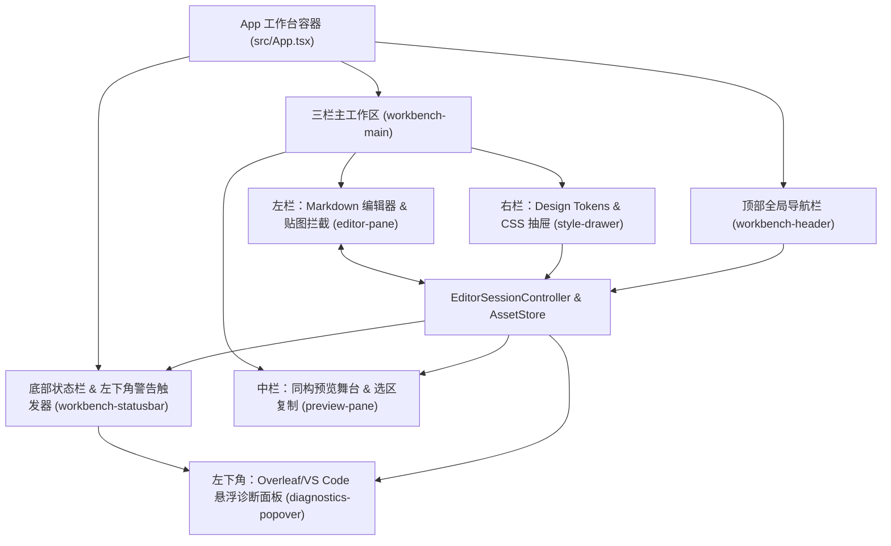

# 实现 MorphMD 双栏同构工作台 UI、Notion 炭黑视觉体系与左下角诊断浮层

> **Status:** In Progress · Issue #3 · Created 2026-10-26
> **Affected Architecture:** [docs/architecture/overview.md](../../architecture/overview.md) · [ADR-0002](../../adr/0002-isomorphic-delivery-snapshot-and-asset-pipeline.md)

## 1. 背景与目标 (Context & Goals)

在 [Issue #2](../issue#2/spec.md) 完成全部无 UI 耦合的内核模块（AST 编译与重型块缓存、`AssetStore` 静态资产管线、受控 CSS 白名单内联、三大目标视图归一化器、`Selection Context Normalizer` 选区重建及 `EditorSessionController` 会话状态机）并通过 5,000+ 行超长文档性能优化后，本期（Issue #3）正式构建 `MorphMD` 前端可交互同构工作台 UI。

### 1.1 核心设计原则
1. **Notion 炭黑极简视觉体系（Zero Purple）**：
   - 全局告别高饱和紫色，采用 Notion 经典暖白画布（`#F7F7F5`）、纯白工作面（`#FFFFFF`）、暖灰细边框（`#E9E9E7`）与深炭黑主色（`#37352F`），主操作按钮与激活态统一使用 `#37352F` 炭黑极简风格。
2. **三栏协同同构工作台**：
   - **顶部导航栏**：品牌标识、`wechat`（微信公众号）/ `x-article`（X 长文）/ `cards`（图文卡片）三态切换器、缩放控制、撤销/重做、导出 `.md + assets`、主交付按钮（复制富文本 / 导出高清卡片）与 `样式设置` 抽屉开关。
   - **左栏 Markdown 编辑器**：支持快捷格式工具栏、行号显示、粘贴/拖拽图片自动入库 `AssetStore` 并插入 `morph-asset://<id>` 短链接、实时行列与字数统计。
   - **中栏同构预览舞台**：100% 消费 `EditorSessionController` 产出的版本化 `DeliverySnapshot`，支持画布尺寸/卡片比例（`3:4` / `4:5` / `1:1` / `16:9`）实时切换、源码映射检视，以及右栏鼠标局部框选（`Cmd/Ctrl + C`）经 `normalizeSelectionRange` 带样式与图片自由复制。
   - **右栏可折叠样式设置抽屉**：支持 `主题`、`排版`、`自定义 CSS` 调节，内置四款无紫色系主题预设（`默认` / `简约` / `杂志` / `科技`）、主题色色板、中西文与等宽字体选择、字号/行高/段落间距滑块及受控自定义 CSS 实时注入。
3. **Overleaf / VS Code 风格左下角警告与诊断浮层**：
   - 底部状态栏左侧常驻渲染就绪指示、图片加载计数与**警告/问题徽章按钮**（如 `⚠ N 个警告`）。
   - 点击左下角警告徽章时，在左栏编辑器左下方弹出 **Overleaf 风格悬浮诊断抽屉（Problems Popover）**，集中展示 `DeliverySnapshot.diagnostics`（如 `x-article` 样式能力守卫降级告警、危险 CSS 拦截、卡片超高块缩放提示等），支持按严重级别过滤及点击定位至对应源码行。

---

## 2. 方案设计 (Design & Contracts)

### 2.1 UI 组件架构拓扑

### 2.2 视觉色板契约（Notion Charcoal Palette）

| 语义变量 | 色值 | 用途说明 |
| :--- | :--- | :--- |
| `--ui-bg-canvas` | `#f7f7f5` | 页面背景与预览舞台暖灰底色 |
| `--ui-bg-surface` | `#ffffff` | 编辑器、预览画布纸张、右侧抽屉与左下角诊断浮层纯白底色 |
| `--ui-bg-subtle` | `#f1f1ef` | 顶部视图切换槽、次级胶囊背景 |
| `--ui-bg-hover` | `#efefed` | 按钮、工具栏图标与列表项悬停态 |
| `--ui-border` | `#e9e9e7` | 面板分割线、卡片与输入框常规边框 |
| `--ui-ink` | `#37352f` | 主文本、标题、主操作按钮背景色（炭黑极简风） |
| `--ui-ink-secondary` | `#787774` | 次级说明文字、非激活 Tab 文本 |
| `--ui-ink-muted` | `#9b9a97` | 行号、占位符、底部辅助统计信息 |
| `--ui-status-ready` | `#0f7b6c` | 渲染就绪状态圆点与成功提示 |
| `--ui-status-warn-fg` | `#d9730d` | 左下角警告徽章文字与图标色（Overleaf 暖琥珀色） |
| `--ui-status-warn-bg` | `#faebdd` | 警告徽章与警告诊断项浅色背景 |
| `--ui-status-error-fg` | `#e03e3e` | 错误徽章与错误诊断项文字色 |

### 2.3 核心组件与 DOM 测试契约（`data-testid`）

1. **顶层入口与属性（[`src/App.tsx`](../../../src/App.tsx)）**：
   - `AppProps`:
     - `initialMarkdown?: string`：初始 Markdown 文档（默认内置涵盖标题、粗体、引用、编号小节、列表与 `morph-asset://cover-1` 示例图片的展示文稿）。
     - `initialTargetId?: TargetId`：初始视图（默认 `'wechat'`）。
     - `initialDrawerOpen?: boolean`：右侧样式抽屉初始开合状态（默认 `true`）。
     - `session?: EditorSessionController`：可选外部注入的会话控制器。
     - `assetStore?: AssetStore`：可选外部注入的资产中心。
     - `debounceMs?: number`：编辑器输入防抖窗口（默认 `60` ms）。
     - `onCopyPayload?: (payload: ClipboardPayload) => void`：全文复制或右栏局部选区复制完成时的回调。
     - `onExportPackage?: (manifest: AssetPackageManifest) => void`：点击「导出 .md + assets」时的回调。
     - `onExportCardsZip?: (result: CardsZipExportResult) => void`：在 `cards` 视图导出卡片 ZIP 时的回调。

2. **顶部导航栏（`data-testid="workbench-header"`）**：
   - 视图切换按钮：`data-testid="target-tab-wechat"`、`data-testid="target-tab-x-article"`、`data-testid="target-tab-cards"`（通过 `aria-pressed="true|false"` 反映当前选中视图）。
   - 缩放选择：`data-testid="zoom-select"`（支持 `75%`、`100%`、`125%`、`150%`）。
   - 历史操作：`data-testid="undo-btn"`、`data-testid="redo-btn"`。
   - 源码包导出：`data-testid="export-package-btn"`（调用 `assetStore.exportPackageManifest`）。
   - 主交付按钮：`data-testid="primary-delivery-btn"`（在 `wechat` / `x-article` 下为「复制富文本」，调用 `serializeFullSnapshot`；在 `cards` 下为「导出高清卡片」，调用 `exportCardsZipPackage`）。
   - 样式抽屉开关：`data-testid="toggle-style-drawer-btn"`。

3. **左栏 Markdown 编辑器（`data-testid="editor-pane"`）**：
   - 快捷格式栏：`data-testid="toolbar-insert-image"`、`data-testid="toolbar-insert-link"`、`data-testid="toolbar-insert-table"`、`data-testid="toolbar-insert-ul"`、`data-testid="toolbar-insert-ol"`、`data-testid="toolbar-insert-code"`。
   - 源码编辑区：`data-testid="markdown-input"`（同步维护可访问文本域与行号列 `data-testid="editor-line-numbers"`，支持键盘输入、粘贴图片文件自动转 `morph-asset://<id>` 短链接及诊断行跳转高亮）。
   - 底部统计栏：`data-testid="editor-footer"`（展示当前行列号与字符数）。

4. **中栏同构预览舞台（`data-testid="preview-pane"`）**：
   - 预览子工具栏：
     - 模式切换：`data-testid="preview-mode-render"`（预览）与 `data-testid="preview-mode-sourcemap"`（源码映射检视）。
     - 画布/比例选择器：`data-testid="canvas-preset-select"`（在 `cards` 视图下提供 `3:4`、`4:5`、`1:1`、`16:9` 四个预设选项，切换后实时调用 `session.updateStyle({ cardsOptions: { ratio } })` 重排卡片分页）。
   - 预览容器：`data-testid="preview-stage"`（携带 `data-target-view={targetId}` 与 `data-card-ratio={cardRatio}` 属性，监听原生 `copy` 事件并通过 `normalizeSelectionRange` 写回结构化 HTML 与纯文本）。

5. **三栏可拖拽宽度排布与右栏样式设置抽屉（`data-testid="style-drawer"`）**：
   - **三栏可拖拽分隔条（Resizable Splitters）**：
     - 左栏与中栏之间挂载 `data-testid="resizer-editor-preview"`（`role="separator"`，`aria-orientation="vertical"`），支持鼠标拖拽（`mousedown` -> `mousemove` -> `mouseup`）与双击重置，动态调节左栏 `editor-pane` 宽度（范围 `260px..720px`）。
     - 中栏与右栏之间挂载 `data-testid="resizer-preview-drawer"`（`role="separator"`，`aria-orientation="vertical"`），支持鼠标拖拽与双击重置，动态调节右栏 `style-drawer` 宽度（默认加宽至 `396px`，范围 `330px..660px`），中栏 `preview-pane` 自适应填充剩余宽度。
   - 无滚动条条纹的整洁布局：面板内部隐藏原生滚动条（`scrollbar-width: none`），「主题」与「排版」面板保持清晰的左标签右控件单行对齐与 2×2 纸张网格，确保标准桌面视口下完整可见。
   - 顶部 Tab（常驻固定于抽屉顶部，点击严格切换下方独立面板）：
     - `data-testid="style-tab-theme"`（主题） -> 对应面板 `data-testid="style-panel-theme"`
     - `data-testid="style-tab-typography"`（排版） -> 对应面板 `data-testid="style-panel-typography"`
     - `data-testid="style-tab-css"`（自定义 CSS） -> 对应面板 `data-testid="style-panel-css"`
   - **「主题」面板（`style-panel-theme`）**：
     - 主题预设卡片：`data-testid="preset-card-default"`、`data-testid="preset-card-minimal"`、`data-testid="preset-card-magazine"`、`data-testid="preset-card-tech"`。
     - 主题色控制：`data-testid="accent-swatch-#37352f"` 等无紫色系色板按钮及 `data-testid="accent-hex-input"` 十六进制输入框。
     - 画布与纸张底色（2×2 网格）：`data-testid="paper-preset-pure"`（纯白纸张）、`data-testid="paper-preset-warm"`（Notion 暖白）、`data-testid="paper-preset-sepia"`（羊皮护眼）、`data-testid="paper-preset-dark"`（深色极客）。
     - 组件视觉风格与卡片画布装修（单行左标签右控件对齐）：二级标题样式 `data-testid="heading-style-select"`、引用块样式 `data-testid="quote-style-select"`、图片圆角 `data-testid="image-radius-select"`、卡片页眉 `data-testid="card-header-input"`、卡片页码 `data-testid="card-footer-select"`。
   - **「排版」面板（`style-panel-typography`）**：
     - 字体组合：`data-testid="font-sans-select"`、`data-testid="font-serif-select"`、`data-testid="font-mono-select"`。
     - 基础排版：`data-testid="body-size-input"`、`data-testid="line-height-input"`、`data-testid="block-gap-input"`。
     - 段落与字距细节：标题倍率 `data-testid="heading-scale-select"`、正文字距 `data-testid="letter-spacing-input"`、对齐方式 `data-testid="text-align-left"` / `data-testid="text-align-justify"`、首行缩进开关 `data-testid="paragraph-indent-toggle"`、代码字号 `data-testid="code-size-select"`、列表项间距 `data-testid="list-gap-select"`。
   - **「自定义 CSS」面板（`style-panel-css`，In-place Drill-down 原地右滑导航）**：
     - 面板根节点携带 `data-view-mode="list" | "editor"`，内部采用水平滑轨在「样式列表」与「样式代码编辑」之间原地平滑切换，顶部三个 Tab 保持不动：
     - **样式列表层（`data-testid="css-list-view"`）**：
       - 顶部说明与新建按钮：`data-testid="new-css-preset-btn"`（`+ 新建样式`）。
       - 已保存样式列表：`data-testid="css-preset-list"`，内置无紫色系预设方案（如 `data-testid="css-preset-item-default"` 默认样式、`data-testid="css-preset-item-reading"` 阅读增强、`data-testid="css-preset-item-minimal"` 极简灰调、`data-testid="css-preset-item-editorial"` 社论引文）。点击任意样式项即应用其 CSS 并从右侧滑出详情编辑层。
     - **原地右滑详情编辑层（`data-testid="css-drilldown-view"`）**：
       - 顶部左对齐返回标题栏：`←` 返回图标按钮 `data-testid="back-to-css-list-btn"` 紧邻 `新建样式` / `编辑样式` 标题。
       - 样式名称必填项：`样式名称 *` 标签与输入框 `data-testid="css-preset-name-input"`（不渲染「快捷插入」选择器栏）。
       - CSS 代码编辑区：顶部左侧为 `CSS 代码` 标题，右侧为 `? 查看编写指南` 按钮 `data-testid="toggle-css-guide-btn"`；点击 `toggle-css-guide-btn` 弹出模态对话框 `data-testid="css-guide-modal"`（含详细的语义化选择器对照表、Design Tokens 变量说明、常用排版示例与多平台兼容提示，支持点击关闭按钮 `data-testid="close-css-guide-modal-btn"` 或背景遮罩关闭）。下方代码框包含 `1..10` 行号槽与 `data-testid="custom-css-input"`；点击 `+ 新建样式` 进入时，代码框为空，背景层渲染简洁不折行的灰色修改教程（`data-testid="css-tutorial-overlay"`），用户输入任意字符后灰色教程立即消失。
       - 底部操作栏：新建模式下右侧展示 `取消`（`data-testid="cancel-css-preset-btn"`）与 `保存`（`data-testid="save-css-preset-btn"`）；编辑已有样式时左侧额外展示 `删除`（`data-testid="delete-css-preset-btn"`）。

6. **底部状态栏与左下角 Overleaf/VS Code 诊断浮层（`data-testid="workbench-statusbar"`）**：
   - 左下角状态项：
     - `data-testid="status-render-state"`（渲染就绪 / 编译中）
     - `data-testid="status-asset-count"`（图片加载进度）
     - `data-testid="status-diagnostics-trigger"`（警告/错误计数徽章按钮，含 `aria-expanded` 状态）
     - `data-testid="status-adapter-info"`（当前适配器与页数状态）
   - 左下角悬浮诊断面板（`data-testid="diagnostics-popover"`）：
     - 点击 `status-diagnostics-trigger` 在左下角展开/收起；
     - 内部包含过滤按钮（`data-testid="diag-filter-all"`、`data-testid="diag-filter-warning"`、`data-testid="diag-filter-error"`）、关闭按钮（`data-testid="close-diagnostics-btn"`）与诊断列表（`data-testid="diagnostics-list"`，每项为 `data-testid="diagnostic-item"`，其 `data-code` 直接透传内核 `DiagnosticItem.code`，例如 `style/disallowed-position`、`style/platform-unsupported-custom-css`、`style/platform-unsupported-tokens`、`style/unauthorized-overflow` 等）。
     - 点击诊断项（或其中的定位动作）可将左栏编辑器光标定位到对应的源码行并展示高亮状态。

---

## 3. 真实执行与验收标准 (Verification)

### 3.1 实施与验收 Checklist

- [x] 由独立子代理（Fresh Subagent）严格依据本 Spec 编写黑盒 UI 测试套件 `tests/test_workbench_ui.test.ts`，并在实现前确认红灯失败（TDD Red Phase）。
- [x] 实现 Notion 炭黑极简风样式表（`src/styles/workbench.css`）与主题预设（`src/ui/presets.ts`），确保全局无高饱和紫色，色彩与 Notion 页面对齐。
- [x] 实现三栏同构工作台组件（`src/App.tsx` 及 `src/ui/` 子模块），打通左栏编辑/贴图、中栏三视图切换与多比例卡片预览、右栏选区自由复制、全文复制与 ZIP/包导出、右侧样式抽屉实时调控。
- [x] 实现底部状态栏与左下角 Overleaf / VS Code 风格悬浮诊断面板（`diagnostics-popover`），验证 `x-article` 样式能力守卫警告与危险 CSS 拦截警告的实时计数、弹窗展开、级别筛选与源码行定位。
- [x] 通过 `tests/test_workbench_ui.test.ts` 全量黑盒测试与真实 Playwright Chromium 浏览器端到端渲染验证，在 `artifacts/` 下产出真实界面截图与交互验证回执，并通过 `npm run typecheck` 与 `harness doctor`。
